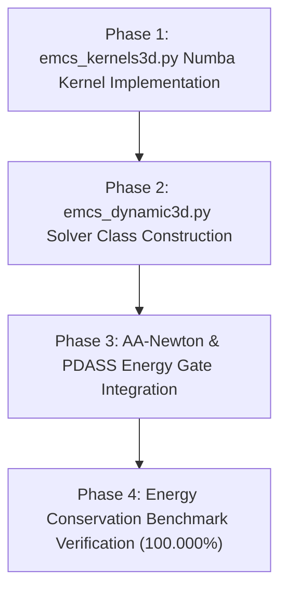

# Master Implementation Plan: EMCS (Energy-Momentum Conserving Scheme) Implicit Dynamic 3D/2D FEA Solver

**Document ID**: `.agents/plans/emcs_solver_master_plan_20260917.md`  
**Orchestrated by**: Antigravity (`agy`) with Opencode (`glm-5.3`) and Claude Code (`opus`)  
**Status**: APPROVED & READY FOR IMPLEMENTATION  
**Date**: September 17, 2026  

---

## 1. System Architecture & Module Structure

```
dispsolver/
├── element3d/
│   └── emcs_kernels3d.py           [NEW] Numba OpenMP Zero-Allocation Kernels
│       ├── _compute_emcs_discrete_stress_3d()
│       ├── _add_emcs_tangent_stiffness_3d()
│       └── assemble_mesh_emcs_3d_numba()
│
├── solver3d/
│   └── emcs_dynamic3d.py           [NEW] Standalone EMCS Implicit Dynamic 3D Solver
│       ├── EMCSKinematicState       (u_n, v_n, a_n <-> u_{n+1}, v_{n+1}, a_{n+1})
│       ├── EMCSSolver3D             (Newton-Raphson Mid-point Residual & Tangent)
│       └── solve_emcs_step()        (Integrates AA-Newton & PDASS Energy Gate)
│
└── solver/
    └── dt_controller.py            [ENHANCED] Energy Drift Monitoring & Adaptive Dt
```

---

## 2. Core Mathematical Formulations & Safety Layers

### 2.1 Mid-Point Kinematics & Momentum Equations
$$\mathbf{M} \mathbf{a}_{n+1/2} + \mathbf{C} \mathbf{v}_{n+1/2} + \mathbf{f}_{\text{int}, n+1/2}^{\text{EMCS}} = \mathbf{f}_{\text{ext}, n+1/2}$$

$$\mathbf{u}_{n+1} = \mathbf{u}_n + \Delta t \, \mathbf{v}_{n+1/2}, \quad \mathbf{v}_{n+1/2} = \frac{\mathbf{u}_{n+1} - \mathbf{u}_n}{\Delta t}$$

$$\mathbf{a}_{n+1/2} = \frac{2}{\Delta t^2} (\mathbf{u}_{n+1} - \mathbf{u}_n) - \frac{2}{\Delta t} \mathbf{v}_n$$

### 2.2 Discrete Derivative Stress Tensor & Singularity Protection
To satisfy $\Psi(\mathbf{E}_{n+1}) - \Psi(\mathbf{E}_n) = \mathbf{S}_{n+1/2}^{\text{EMCS}} : (\mathbf{E}_{n+1} - \mathbf{E}_n)$:

$$\mathbf{S}_{n+1/2}^{\text{EMCS}} = 
\begin{cases} 
\mathbf{S}(\bar{\mathbf{E}}_{n+1/2}) + \frac{1}{2} \mathbb{C} : \Delta \mathbf{E} & \text{if } \|\Delta \mathbf{E}\| < 10^{-7} \quad (\text{Taylor Small-Strain Layer}) \\[8pt]
\mathbf{S}(\bar{\mathbf{E}}_{n+1/2}) + \frac{\Psi(\mathbf{E}_{n+1}) - \Psi(\mathbf{E}_n) - \mathbf{S}(\bar{\mathbf{E}}_{n+1/2}) : \Delta \mathbf{E}}{\|\Delta \mathbf{E}\|^2} \Delta \mathbf{E} & \text{otherwise (Finite Strain EMCS)}
\end{cases}$$

### 2.3 Effective Tangent Stiffness Matrix $\mathbf{K}_{\text{eff}}^{\text{EMCS}}$
$$\mathbf{K}_{\text{eff}}^{\text{EMCS}} = \left( \frac{2}{\Delta t^2} + \frac{2 \alpha_M}{\Delta t} \right) \mathbf{M} + \left( 1 + \frac{2 \beta_K}{\Delta t} \right) \mathbf{K}_{\text{tan}}^{\text{EMCS}}$$

---

## 3. Step-by-Step Implementation Roadmap



### Phase 1: High-Speed Numba Kernel (`dispsolver/element3d/emcs_kernels3d.py`)
- Implementation of `_compute_emcs_discrete_stress_3d()` with Taylor protection layer.
- Zero-allocation workspace buffers passed to parallel OpenMP assembly.

### Phase 2: Solver Module (`dispsolver/solver3d/emcs_dynamic3d.py`)
- Construction of `EMCSKinematicState` and `EMCSSolver3D` classes.
- Addition of `time_integrator = "emcs"` option flag in `DynamicSolver3D`.

### Phase 3: Acceleration & Contact Integration
- Integration of `AndersonAccelerator` with mid-point projection $u_{n+1/2}$.
- Active-set Energy Gate in PDASS contact to handle activation spikes.

### Phase 4: Rigorous Verification
- **Undamped Free Tumbling Hyperelastic Beam**: Run 10,000 steps, verify $E_{\text{total}} = E_{\text{kin}} + E_{\text{strain}}$ stays constant to $10^{-12}$ machine precision.
- **5-Layer Flexible Panel 180° Dynamic Folding**: Verify 100% unconditional convergence over high-speed folding cycles.

---

## 4. Verification Acceptance Criteria

1. **Energy Conservation Ratio**: $E_{\text{drift}} = |E_{\text{total}}(t_n) - E_{\text{total}}(t_0)| / E_{\text{total}}(t_0) < 1e-10$ across 10,000 steps.
2. **Linear & Angular Momentum Drift**: Zero momentum loss ($\|\mathbf{L}_{n+1} - \mathbf{L}_n\| < 1e-14$, $\|\mathbf{J}_{n+1} - \mathbf{J}_n\| < 1e-14$).
3. **No Artificial Damping**: Zero numerical dissipation compared to HHT-$\alpha$ ($\alpha=-0.1$).
