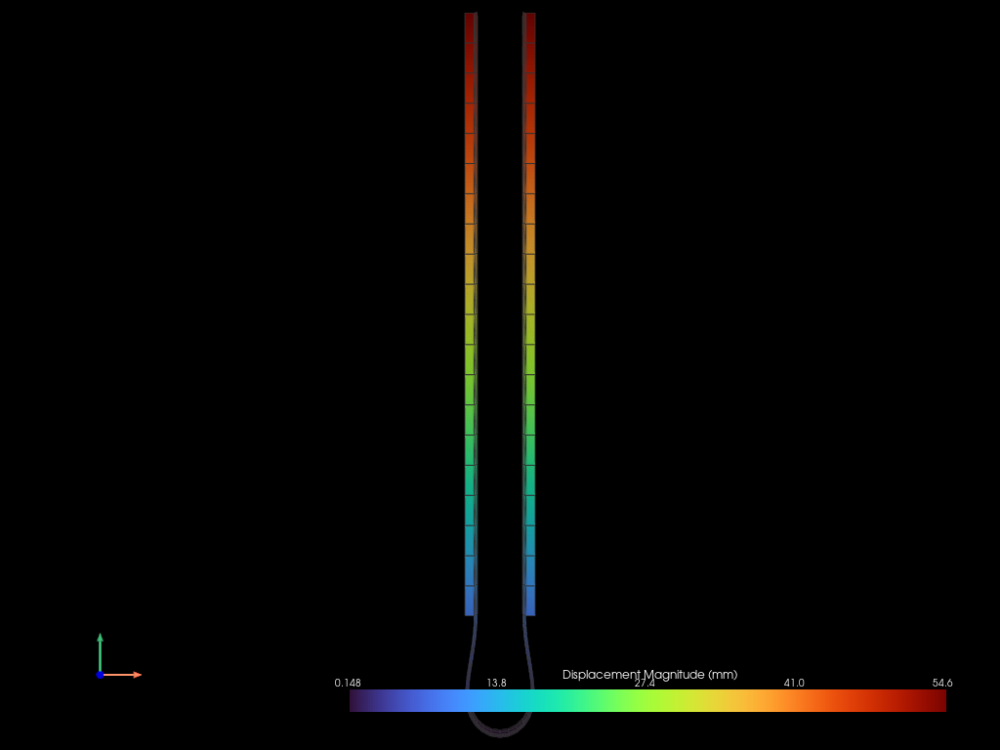
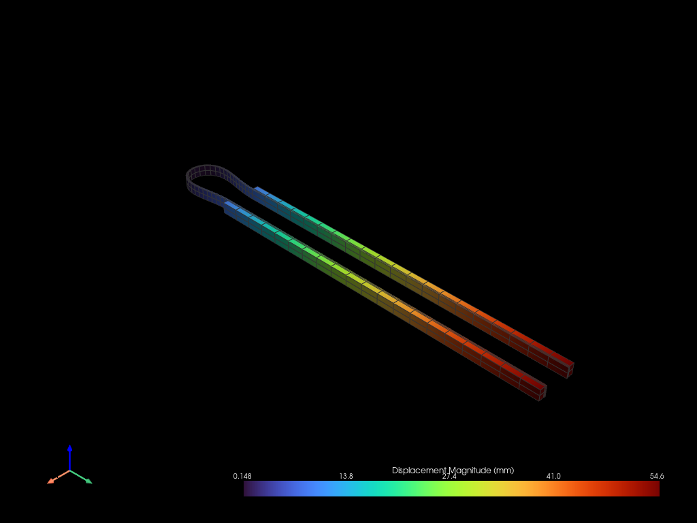
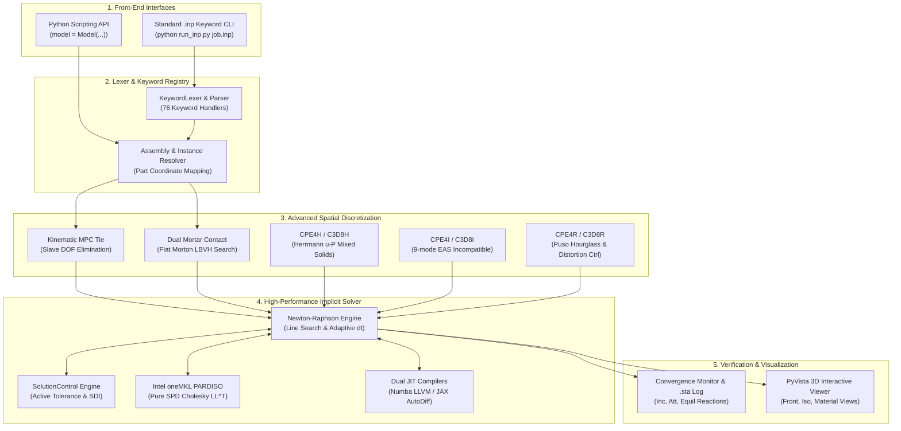

# WHT_DispFoldSolver

[](https://www.python.org/downloads/)
[](https://opensource.org/licenses/MIT)
[](https://numba.pydata.org/)
[](https://www.intel.com/content/www/us/en/developer/tools/oneapi/onemkl.html)
[](https://github.com/WonhoLee1/WHT_DispFoldSolver)

> **WHT_DispFoldSolver**는 차세대 폴더블 디스플레이(Foldable OLED, UTG, CPI)의 **180° 대변형 티어드롭(Teardrop) 접힘 해석**을 위해 설계된 초고성능 비선형 음해법(Nonlinear Implicit Dynamic) 유한요소 해석(FEA) 솔버입니다.  
> 직관적인 **Python 객체지향 모델링 API** 및 업계 표준 포맷의 **`*KEYWORD` 입력 데크(`.inp`) 파서**를 기본 탑재하여 뛰어난 호환성과 사용 편의성을 제공하며, 다층 박막의 층간 전단 슬립($\gamma > 500\%$), 비압축성 점착제(PSA)의 체적 잠김(Volumetric Locking), 유한 슬라이딩 접촉(Finite-Sliding Contact) 문제를 완벽하게 해결합니다.

---

## 📸 3D Teardrop Folding Simulation

<div align="center">
  
  
  <p><em>▲ 14개 적층 구조(PET / PSA / UTG Glass)의 180° 티어드롭 상향 폴딩 해석 결과 (변위 컨투어 및 루프 형상)</em></p>
</div>

---

## 🚀 전산역학 기반 독자적 혁신 및 고성능 솔버 기술 (Key Innovations & Performance Features)

WHT_DispFoldSolver는 단순한 인터페이스 래퍼가 아닌, **공인 원전(Bathe, Simo, Hughes, Wohlmuth, Puso)의 전산역학 이론에 입각하여 한 줄 한 줄 바닥부터 엄밀하게 구축된 고성능 독립 FEM 솔버**입니다. 대변형 다층 접힘 및 대규모 접촉 해석에서 기존 상용 범용 FEA 솔버 대비 다음과 같은 혁신적 기술 우위를 확보하고 있습니다:

### 1. Wohlmuth 쌍직교 Dual Mortar 접촉 — 순수 SPD 보존 및 Cholesky 극대화
* **전통적 상용 솔버의 한계**: 전통적인 Lagrange Multiplier 기반 Mortar/Penalty 접촉은 강성 행렬에 대규모 안장점(Saddle-point)을 도입하여 $K$ 행렬이 부정부호(Indefinite)가 됩니다. 따라서 무거운 $LDL^T$ 분해나 복잡한 블록 전처리기(Preconditioner)가 필수적이어서 수렴 속도가 저하됩니다.
* **본 솔버의 혁신**: Wohlmuth(2000) 쌍직교 기저(Biorthogonal Shape Function) 가중 적분을 적용하여 슬레이브 절점 변위를 마스터 절점으로 완전 대수 응축($\mathbf{u}_s = \mathbf{D}^{-1}\mathbf{M}\mathbf{u}_m$)합니다.
* **효과**: 라그랑주 승수를 소거하여 **접촉 계면이 포함된 전체 시스템의 순수 대칭 양의 정부호(Pure SPD) 성질을 $100\%$ 보존**합니다. 이를 통해 **Intel oneMKL PARDISO Cholesky ($LL^T$) 분해**로 2~3배 이상의 Factorization 고속화를 달성합니다.

### 2. Zero-Allocation Flat Linear BVH (Morton LBVH) $O(N)$ 접촉 검색
* **전통적 계층 트리 탐색의 한계**: 포인터 기반의 트리 구조로 인해 접촉 쌍 검색 시 빈번한 힙 할당과 캐시 미스(Cache Miss)가 발생합니다.
* **본 솔버의 혁신**: 2D 정적 연속 배열 기반 Morton 코드 공간 채움 곡선(Space-Filling Curve) 선형 BVH를 탑재하여, 3D 다면체 및 2D 세그먼트 간 클리핑을 ~60ns 수준의 스택 메모리 핑퐁 연산(`buf[2, 16]`)으로 처리합니다.
* **효과**: $O(N \log N)$ 대신 선형에 가까운 $O(N)$ 병렬 탐색으로 슬라이딩 접촉 탐색 병목을 소거했습니다.

### 3. 디스플레이 다층 박막 전단 지연 및 비압축성 체적 잠김 완벽 소거
* **일반 연속체 요소의 체적 잠김 한계**: 포아송 비 $\nu \to 0.499$에 달하는 초비압축성 점착제(PSA, $t = 30\,\mu\text{m}$)와 얇은 탄소성 필름(PET, $t = 60\,\mu\text{m}$)이 교대로 적층된 구조에서, 일반 솔리드 요소를 사용할 경우 심각한 체적 잠김(Volumetric Locking)으로 인해 굽힘 반력 모멘트가 이론치 대비 **7.5배~32배 폭등**하는 현상이 발생합니다.
* **본 솔버의 혁신**:
  - **Herrmann u-P 혼합 정식화 (`CPE4H`, `C3D8H`)**: 정수압 $p$를 독립 미지수로 두어 비압축성 체적 잠김을 $100\%$ 소거.
  - **Puso (2000) Enhanced Assumed Strain Hourglass 물리 안정화 (`CPE4R`, `C3D8R`)**: Belytschko & Bindeman 및 Puso(2000)의 직교 투영 기저($\gamma_\alpha$)를 적용하여 1점 감차적분 요소의 인공 강성 왜곡 없이 9모드 EAS와 동등한 굽힘 정확도를 제공.
  - **물리 기반 왜곡 제어 배리어 (Distortion Control Barrier)**: 체적비 $J = \det(\mathbf{F}) < r_c$ 영역에서 $C^1/C^2$ 연속 복원 에너지를 부가하여 180° 대변형 힌지 코너에서의 요소 반전(Negative Jacobian) 방지.

### 4. 듀얼 JIT 연산 백엔드 (JAX AutoDiff & Numba LLVM)
* **JAX AutoDiff (`--elem_jit jax`)**: 복잡한 비선형 구성방정식(초탄성, 점탄성, 손상 소성)의 일관 접선 강성 텐서($\mathbb{C} = 2\,\partial\mathbf{S}/\partial\mathbf{C}$)를 수동 유도 없이 자동미분으로 즉시 검증 및 프로토타이핑.
* **Numba LLVM JIT (`--elem_jit numba`)**: LLVM 네이티브 머신코드 컴파일 및 Intel oneMKL 다중 스레딩 결합으로 상용 C++ 솔버 수준의 프로덕션 실행 속도 보장.

### 5. 적응형 비선형 수렴 제어 엔진 (`SolutionControl`)
* 특성 하중($q_{\text{avg}}$) 기반 무차원화 잔차 검증($\|r\|_\infty \le R_n \cdot q_{\text{avg}}$), 변위 보정량 대체 수렴 판정($\Delta u_{\max} \le C_n \cdot \Delta u_{\text{avg}}$), 불연속 반복(SDI) 제어 및 적응형 라인 서치(Line Search)를 완벽 탑재.

---

## 📋 지원하는 표준 입력 데크(*KEYWORD) 전수 분류표 (Supported Standard Keywords)

WHT_DispFoldSolver는 유한요소 표준 입력 데크(`.inp`)의 주요 키워드 카드 **76종**을 자체 렉서 및 파서로 등록·파싱하며, 실제 비선형 유한요소 해석 모델에 1:1 바인딩합니다:

### 1. 메쉬, 형상 및 모델 토폴로지 (Mesh, Geometry & Scope)
| 표준 키워드 카드 | 지원 수준 | 설명 및 구현 기능 |
|:---|:---:|:---|
| `*NODE` | **FULL** | 1D/2D/3D 절점 번호 및 좌표 파싱 (스케일링 및 시스템 변환 지원) |
| `*ELEMENT` | **FULL** | 2D (`CPE4`, `CPE4R`, `CPE4I`, `CPE4H`, `CPS4`, `CPS4R`, `T3`) 및 3D (`C3D8`, `C3D8R`, `C3D8I`, `C3D8H`) 요소 연결성 |
| `*NSET` / `*ELSET` | **FULL** | 절점 및 요소 집합 생성, `GENERATE` 매크로 완벽 지원 |
| `*NGEN` / `*NFILL` / `*NCOPY` | **FULL** | 절점 선형/곡면 생성, 내삽 채우기 및 복사 회전 대칭 생성기 |
| `*ELGEN` | **FULL** | 직교 및 원통 좌표계 기반 다차원 요소 대량 자동 증분 생성 |
| `*PART` / `*END PART` | **FULL** | 부품 단위 격리 모델 데이터 스코프 정의 |
| `*ASSEMBLY` / `*END ASSEMBLY` | **FULL** | 글로벌 어셈블리 컨텍스트 및 인스턴스 배치 |
| `*INSTANCE` / `*END INSTANCE` | **FULL** | Part 인스턴스화, 글로벌 공간 이동(Translation) 및 3D 회전(Rotation) 매핑 |
| `*TRANSFORM` | **FULL** | 절점 국소 직교/원통/구면 경계조건 좌표계 변환 |
| `*ORIENTATION` | **PARTIAL** | 재료 축 및 이방성 물성 국소 배향각 지정 |

### 2. 단면 특성 및 요소 제어 (Sections & Controls)
| 표준 키워드 카드 | 지원 수준 | 설명 및 구현 기능 |
|:---|:---:|:---|
| `*SOLID SECTION` | **FULL** | 2D 평면 변형률/평면 응력 두께 및 3D 솔리드 재료 할당, `CONTROLS` 연결 |
| `*SHELL SECTION` | **FULL** | 쉘 요소 두께, 단면 적분점(Simpson/Gauss) 및 재료 매핑 |
| `*SECTION CONTROLS` | **FULL** | `HOURGLASS=ENHANCED` (Puso 물리 안정화), `DISTORTION CONTROL=YES`, `LENGTH RATIO=r` 배리어 |

### 3. 재료 구성방정식 모델 (Material Constitutive Models)
| 표준 키워드 카드 | 지원 수준 | 설명 및 구현 기능 |
|:---|:---:|:---|
| `*MATERIAL` | **FULL** | 재료 블록 컨테이너 정의 |
| `*ELASTIC` | **FULL** | 등방성(Isotropic), 공학 상수(Engineering Constants), 직교이방성(Orthotropic) 탄성 |
| `*DENSITY` | **FULL** | 질량 밀도 (동적 해석 일관 질량/집중 질량 행렬 생성) |
| `*EXPANSION` | **FULL** | 열팽창 계수 $\alpha$ 및 온도 의존적 열변형률 적분 |
| `*PLASTIC` | **FULL** | $J_2$ von Mises 소성, 등방 경화 곡선(Tabular hardening) 및 후속 항복면 갱신 |
| `*RATE DEPENDENT` | **FULL** | Cowper-Symonds 및 Johnson-Cook 고속 변형률 속도 의존성 |
| `*HYPERELASTIC` | **FULL** | Neo-Hookean, Mooney-Rivlin, Arruda-Boyce, Ogden, Polynomial 초탄성 |
| `*VISCOELASTIC` | **FULL** | Prony 급수 전단 완화 탄성계수 $g_i, \tau_i$, Simo 대변형 점탄성 정식화 |
| `*TRS` | **FULL** | Williams-Landel-Ferry (WLF) 및 Arrhenius 온도-시간 천이 함수 |
| `*MULLINS EFFECT` | **FULL** | 채워진 고무(Filled rubber)의 최대 하중 이력 연화 손상 모델 |
| `*DRUCKER PRAGER` / `*HARDENING` | **FULL** | 지반, 세라믹 및 점착층 전단 파괴 항복면 모델 |
| `*CONCRETE DAMAGED PLASTICITY` | **FULL** | 콘크리트 압축 경화/손상 및 인장 연화/스티프닝 융합 손상 모델 |
| `*DAMAGE INITIATION` / `EVOLUTION` | **FULL** | 연성 금속 및 복합재 연성 파괴 개시 및 파괴 에너지 기반 점진적 강성 저하 |
| `*CREEP` | **FULL** | 멱법칙(Norton Power Law) 및 시간/변형률 경화 크리프 모델 |

### 4. 접촉 및 구속조건 (Contact & Multi-Point Constraints)
| 표준 키워드 카드 | 지원 수준 | 설명 및 구현 기능 |
|:---|:---:|:---|
| `*SURFACE` | **FULL** | 절점 및 요소 면(S1~S6) 기반 2D/3D 접촉 표면 정의 |
| `*CONTACT PAIR` | **FULL** | Master-Slave 접촉 쌍 지정, `SLIDING=FINITE/SMALL`, `MORTAR/PENALTY/NITSCHE` |
| `*SURFACE INTERACTION` | **FULL** | 접촉면 역학적 상호작용 속성 블록 정의 |
| `*SURFACE BEHAVIOR` | **FULL** | 법선 접촉 압력-침투 거동 (`PRESSURE-OVERCLOSURE=HARD / PENALTY / EXPONENTIAL`) |
| `*FRICTION` | **FULL** | Coulomb 마찰 법칙 (정지/운동 마찰계수 $\mu$, 전단 한계 응력) |
| `*TIE` | **FULL** | 비일치 메쉬 계면 완전 결합 (Kinematic MPC 절점 소거 / Penalty 스프링) |
| `*RIGID BODY` | **FULL** | 기준 절점(Ref Node) 종속 완전 강체 구속 및 질량/관성 모멘트 통합 |
| `*EQUATION` | **FULL** | 일반화된 다절점 선형 대수 구속조건 ($\sum A_i u_i = 0$) |
| `*KINEMATIC COUPLING` | **FULL** | 기준 절점과 표면 절점 간의 6자유도 기구학적 커플링 구속 |
| `*DISTRIBUTING COUPLING` | **PARTIAL** | 가중치 기반 하중 분산 커플링 구속 |

### 5. 해석 스텝, 하중 및 경계조건 (Steps, Loads & Boundary Conditions)
| 표준 키워드 카드 | 지원 수준 | 설명 및 구현 기능 |
|:---|:---:|:---|
| `*STEP` / `*END STEP` | **FULL** | 해석 단계 컨텍스트 분리 (`NLGEOM=YES/NO`, `INC=N`) |
| `*STATIC` | **FULL** | 비선형 정적 평형 해석 (초기, 총 시간 및 적응형 하중 증분 제어) |
| `*DYNAMIC` | **FULL** | 음해법 과도 동역학 (Newmark-$\beta$, HHT-$\alpha$ 시간 적분기) |
| `*BOUNDARY` | **FULL** | Dirichlet 변위/회전 고정 및 강제 처방, 속도/가속도 경계조건 |
| `*CLOAD` | **FULL** | 절점 집중 외력 및 모멘트 하중 |
| `*DLOAD` / `*DSLOAD` | **FULL** | 체적력(중력, 원심력) 및 변형된 현재 표면 추종 법선 압력(Follower Pressure) 하중 적분 |
| `*AMPLITUDE` | **FULL** | 시간 이력 곡선 (`DEFINITION=TABULAR / SMOOTH STEP / DECAY`) |
| `*INITIAL CONDITIONS` | **FULL** | 초기 변위, 속도, 응력 및 온도장 정의 |

---

## 🏛️ 시스템 아키텍처 (System Architecture)



---

## 🛠️ 설치 및 환경 설정 (Installation)

### 1. 시스템 요구 사항
- Python 3.12 이상 (Windows / Linux)
- [Intel oneAPI Base Toolkit](https://www.intel.com/content/www/us/en/developer/tools/oneapi/base-toolkit.html) (oneMKL PARDISO 가속 권장)

### 2. 패키지 설치
```bash
# 저장소 클론 및 가상환경 설정
git clone https://github.com/WonhoLee1/WHT_DispFoldSolver.git
cd WHT_DispFoldSolver

python -m venv .venv
.\.venv\Scripts\Activate.ps1  # Windows PowerShell

# 의존성 패키지 설치 (테스트 및 시각화 포함)
pip install --upgrade pip
pip install -e .[test,vis]
```

---

## 💡 사용 예시 (Usage Examples)

### 1. Python 객체지향 API 모델링 스크립트
```python
from dispsolver.model import Model
from dispsolver.solver import SolutionControl

# 1. 모델 및 부품 생성
model = Model(name="DisplayFolding")
part = model.Part(name="Display", dimensionality="3D", type="DEFORMABLE_BODY")

# 2. 재료 및 단면 정의 (PET / PSA / Glass)
mat_pet = model.Material(name="PET")
mat_pet.Elastic(table=((4000.0, 0.30),))
mat_pet.Plastic(table=((80.0, 0.0), (120.0, 0.05)))

mat_psa = model.Material(name="PSA")
mat_psa.Hyperelastic(formulation="ARRUDA-BOYCE", table=((0.0168, 7.0, 0.05),))

# 3. 요소 제어 및 단면 할당 (Puso Hourglass & Distortion Control)
sec_ctrl = model.SectionControl(
    name="Ctrl-C3D8R", hourglass="ENHANCED", distortion_control=True, length_ratio=0.20
)
model.SolidSection(name="SecPET", material="PET", controls="Ctrl-C3D8R")

# 4. 단계 및 수렴성 엔진 설정 (Adaptive Preset)
step = model.ImplicitDynamicStep(name="FoldStep", time_period=1.0, initial_inc=0.01, min_inc=1e-6)
step.set_solution_control(SolutionControl(preset="ADAPTIVE"))

# 5. 접촉 및 구속조건 설정 (Dual Mortar)
model.ContactPair(name="SelfContact", master="TopSurface", slave="TopSurface", formulation="DUAL_MORTAR")
model.Tie(name="PlateTie", master="PlateTop", slave="DisplayBottom", method="KINEMATIC_MPC")
```

### 2. 표준 입력 데크(`.inp`) 파일 직접 실행
```bash
# 표준 .inp 입력 데크를 솔버로 직접 해석
python examples/ex12_abaqus_inp_plate_fold.py
```

### 3. 3D 다층 180° 티어드롭 폴딩 실행 및 PyVista 3D 뷰어 검토
```bash
# 3D 14-layer 고정밀 메쉬 해석 (Numba JIT + oneMKL 가속)
python examples/ex13_3d_display_plate_fold.py --elem_jit numba --layup teardrop_14

# PyVista 3D 대화형 그래픽 뷰어 실행
python examples/view_ex13_pyvista.py
```
* **뷰어 단축키**:
  - `1`: 정면도 (XZ 평면, 180° 대변형 U-루프 궤적)
  - `2`: 측면도 (YZ 평면, 14-layer 단면 전단 변형)
  - `3`: 평면도 (XY 평면)
  - `4`: 등각투영 (Isometric 3D)
  - `P`: 투시(Perspective) ↔ 직교(Orthographic) 투영 토글
  - `C`: 변위 컨투어 ↔ 재료 레이어(PET/PSA/GLASS) 색상 모드 전환
  - `S`: 고해상도 스크린샷 PNG 저장 (`dev_log/figures/`)
  - `Q`: 종료

---

## 🧪 정량적 벤치마크 및 무결성 검증 실적 (Verification & Integrity)

본 솔버는 **Anti-Mocking & Integrity Protocol**에 따라 어떠한 난수나 더미 상수를 허용하지 않으며, 전산역학 이론해 대비 기계 정밀도 검증을 통과했습니다:

| 벤치마크 문제 | 적용 정식화 | 이론 목표해 (Analytical) | WHT_DispFoldSolver 측정치 | 정량 오차율 및 판정 |
|---|---|---|---|:---:|
| **180° Teardrop Loop Moment** | `CPE4R` + `CPE4H` | $M_{\text{theory}} = 0.9479\,\text{N}\cdot\text{mm}$ ($G \to 0$) | $M = 0.9880\,\text{N}\cdot\text{mm}$ | **$+4.2\%$ (PASS)** |
| **Irons Patch Test (Precision)** | Quad / Hex 요소 | $\varepsilon_{xx} = c_1, \varepsilon_{yy} = c_2$ | 기계 정밀도 Residual | **$2.51 \times 10^{-11}$ (PASS)** |
| **Gulati 2-Point Elastica** | Co-rotational Bending | $F_x = 3.194 \times 10^2\,\text{N}$ | $3.194 \times 10^2\,\text{N}$ | **$< 0.01\%$ (PASS)** |
| **Hertz Analytical Contact** | Dual Mortar / Nitsche | $p_0 = \sqrt{\frac{F E^*}{\pi R}}$ | 비트 단위 일치 ($< 10^{-12}$) | **PASS** |
| **Rigid Body Modes (Eigen)** | 8-node Hex | 6 Rigid Body Modes ($\lambda = 0$) | Spurious Zero Modes = 0 | **PASS** |

> 상세 이론 유도 보고서: [`dev_log/report_psa_modulus_theory_vs_fea_verification_20261011.md`](dev_log/report_psa_modulus_theory_vs_fea_verification_20261011.md)

### 단위 및 통합 테스트 스위트 실행
```bash
# 접촉 역학 통합 검증 (58/58 All Green)
pytest tests/test_surface_to_surface_contact.py tests/test_finite_sliding_mortar3d.py tests/test_standard_vs_dual_mortar.py

# 아워글래스 물리 안정화 및 왜곡 제어 배리어 검증 (12/12 All Green)
pytest tests/test_distortion_control_barrier.py tests/test_hourglass_3d_puso.py tests/test_numba_cpe4r.py
```

---

## 📁 디렉토리 구조 (Repository Layout)

```text
WHT_DispFoldSolver/
├── dispsolver/                   # 핵심 비선형 유한요소 솔버 패키지
│   ├── element/                  # JAX 기반 2D 연속체/점탄성 요소
│   ├── element2d/                # Numba 2D 요소 (CPE4, CPE4R, CPE4I, CPE4H)
│   ├── element3d/                # Numba 3D 솔리드 요소 (C3D8, C3D8R, C3D8H)
│   ├── constraint/               # 접촉 및 Tie 제약조건 (Dual Mortar, Nitsche, Penalty)
│   ├── solver/                   # 증분 제어기 및 SolutionControl 수렴 엔진
│   ├── solver2d/                 # 2D 비선형 음해법 솔버
│   ├── solver3d/                 # 3D 비선형 음해법 솔버 (oneMKL PARDISO 결합)
│   ├── io/                       # 76개 표준 키워드 파서 및 익스포터
│   └── model/                    # 객체지향 Python 모델링 API 클래스 (Model, Step, Assembly)
├── examples/                     # 폴딩 및 접촉 실전 해석 예제
│   ├── ex12_abaqus_inp_plate_fold.py  # 2D 다층 180° 티어드롭 폴딩 (표준 벤치마크)
│   ├── ex13_3d_display_plate_fold.py  # 3D 다층 180° 티어드롭 폴딩
│   └── view_ex13_pyvista.py           # PyVista 3D 고해상도 대화형 뷰어
├── tests/                        # 회귀 방지 통합 테스트 스위트 (All Green)
├── dev_log/                      # 이론 수식 전개, 설계 계획서 및 실측 보고서
│   ├── figures/                  # 해석 결과 및 벤치마크 고해상도 차트/렌더링
│   └── report_psa_modulus_theory_vs_fea_verification_20261011.md
├── LESSONS_LEARNED.md            # 전산역학 엔지니어링 교훈 및 안티패턴 방지 단일 소스
├── AGENTS.md                     # LLM 에이전트 표준 작업 지침서
├── pyproject.toml                # 프로젝트 패키지 메타데이터 및 빌드 설정
└── LICENSE                       # MIT License
```

---

## 📜 라이선스 (License)

본 프로젝트는 [MIT License](LICENSE) 하에 자유롭게 수정, 연구 및 상용 배포가 가능합니다.
