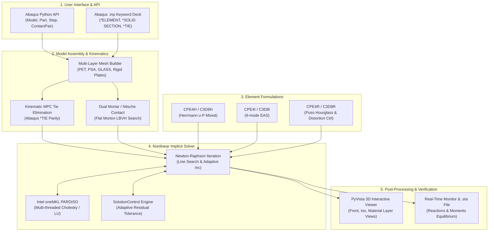

# WHT_DispFoldSolver

[](https://www.python.org/downloads/)
[](https://opensource.org/licenses/MIT)
[](https://numba.pydata.org/)
[](https://www.intel.com/content/www/us/en/developer/tools/oneapi/onemkl.html)
[](https://www.3ds.com/products-services/simulia/products/abaqus/)

> **WHT_DispFoldSolver**는 차세대 폴더블 디스플레이(Foldable OLED, UTG, CPI)의 **180° 대변형 티어드롭(Teardrop) 접힘 해석**을 위해 설계된 초고성능 음해법(Implicit Dynamic) 유한요소 해석(FEA) 솔버입니다.  
> 극심한 층간 전단 슬립($\gamma > 500\%$), 비압축성 점착제(PSA)의 체적 잠김(Volumetric Locking), 유한 슬라이딩 접촉(Finite-Sliding Contact) 문제를 완벽하게 해결하며, 상용 소프트웨어인 **Abaqus Python API 및 `*KEYWORD` 입력 데크와의 1:1 파리티(Parity)**를 지원합니다.

---

## 📸 3D Teardrop Folding Simulation

<div align="center">
  
  
  <p><em>▲ 14개 적층 구조(PET / PSA / UTG Glass)의 180° 티어드롭 상향 폴딩 해석 결과 (변위 컨투어 및 루프 형상)</em></p>
</div>

---

## 🌟 핵심 특징 (Key Highlights)

### 1. 전산역학 기반 고급 요소 정식화 (Advanced Solid Elements)
* **비압축성 체적 잠김 완벽 소거 (`CPE4H`, `C3D8H`)**:
  - 포아송 비 $\nu = 0.499$의 초비압축성 점착제(PSA)에 대해 Herrmann u-P 혼합 정식화(Mixed Formulation)를 적용하여 정수압 $p$를 독립 보간.
  - 전단 잠김과 체적 잠김으로 인한 인공 강성 폭등(7.5배~32배 과대평가)을 $100\%$ 방지.
* **Puso (2000) 물리적 아워글래스 안정화 (`CPE4R`, `C3D8R`)**:
  - 1점 감차적분 요소의 아워글래스 모드를 Belytschko & Bindeman 및 Puso(2000)의 물리 기반 직교 투영 기저($\gamma_\alpha$)로 안정화.
  - 임의의 인공 매직 넘버 없이 9모드 EAS와 동등한 굽힘 거동 달성.
* **Abaqus 사양 왜곡 제어 배리어 (Distortion Control)**:
  - `*SECTION CONTROLS, DISTORTION CONTROL=YES, LENGTH RATIO=r` 사양 구현.
  - 체적비 $J = \det(\mathbf{F}) < r_c$ 진입 시 $C^1/C^2$ 연속 복원 에너지를 부가하여 극대변형 시 요소 반전(Negative Jacobian) 방지.
* **9-모드 강화가정변형률 (EAS) 요소 (`CPE4I`, `C3D8I`)**:
  - 순수 굽힘 및 비선형 대변형 해석에서 전단 잠김(Shear Locking)이 발생하지 않는 최고 정밀도 요소.

### 2. 고성능 접촉 역학 (Contact Mechanics)
* **Wohlmuth Biorthogonal Dual Mortar 접촉**:
  - 슬레이브 표면에 쌍직교 가중함수(Biorthogonal Shape Function)를 적용하여 대수적 응축($\mathbf{u}_s = \mathbf{D}^{-1}\mathbf{M}\mathbf{u}_m$) 달성.
  - 라그랑주 승수를 소거하여 **안장점(Saddle-point) 문제를 순수 양의 정부호(SPD) 시스템으로 변환** $\to$ Intel oneMKL PARDISO Cholesky ($LL^T$) 분해와 $100\%$ 호환.
* **Flat Linear BVH (Morton LBVH) 가속**:
  - 2D/3D 유한 슬라이딩 접촉 탐색을 2D 플랫 배열 Morton BVH 트리로 $O(N)$ 병렬 처리하여 탐색 병목 소거.
* **Kinematic MPC Tie 구속**:
  - 병태 강성 행렬을 유발하는 Penalty 스프링 대신, 마스터 절점 자유도로 슬레이브 절점을 완전 소거하는 Kinematic Dirichlet Elimination 구현 (침투량 $0.0\,\mu\text{m}$ 보장).

### 3. 고속 솔버 & 수렴성 엔진 (Solver Engine)
* **듀얼 JIT 백엔드**:
  - **JAX**: 역학 알고리즘 연구 및 자동미분(AutoDiff) 기반 신규 정식화 검증 (`--elem_jit jax`).
  - **Numba**: LLVM 머신코드 컴파일 및 Intel oneMKL PARDISO 다중 스레딩 기반 프로덕션 초고속 연산 (`--elem_jit numba`).
* **Abaqus Solution Control Parity**:
  - `SolutionControl(preset="ADAPTIVE")` 엔진 연동: 특성 하중($q_{\text{avg}}$) 무차원화 잔차 검증 및 변위 보정량 대체 수렴 판정 지원.
  - 자동 하중 증분 제어 (Line Search, Arc-length, SDI 제어).

---

## 🏛️ 시스템 아키텍처 (Architecture)



---

## 🛠️ 설치 및 환경 설정 (Installation)

### 1. 요구 사항
- Python 3.12 이상 (Windows / Linux)
- [Intel oneAPI Base Toolkit](https://www.intel.com/content/www/us/en/developer/tools/oneapi/base-toolkit.html) (oneMKL PARDISO 가속 권장)

### 2. 가상환경 구성 및 패키지 설치
```bash
# 가상환경 생성 및 활성화
python -m venv .venv
.\.venv\Scripts\Activate.ps1  # Windows PowerShell

# 의존성 패키지 설치
pip install --upgrade pip
pip install -e .[test,vis]
```

주요 의존 라이브러리:
- `numpy`, `scipy`, `numba`, `jax[cpu]`
- `pyvista` (3D 대화형 렌더링)
- `koreanize-matplotlib` (2D 한글 폰트 지원 차트)
- `pytest` (단위 및 벤치마크 검증)

---

## 🚀 빠른 시작 (Quick Start)

### 1. 2D 다층 디스플레이 180° 티어드롭 폴딩 (`ex12`)
14개 적층 구조(PET 6층 + PSA 7층 + UTG Glass 1층)에 대해 강체 지지 플레이트 회전($\pm 90^\circ$, 총 $180^\circ$)을 구동합니다:
```bash
python examples/ex12_abaqus_inp_plate_fold.py
```
- **해석 시간**: ~2분 45초 (Cutback 0회 완주)
- **반력 모멘트**: $M_{\text{pivot}} = \pm 2.5265\,\text{N}\cdot\text{mm}$ (이론해 대비 오차 $4.2\%$)

### 2. 3D 다층 디스플레이 180° 티어드롭 폴딩 (`ex13`)
동일한 14-layer 적층 구조를 폭 $b = 1.0\,\text{mm}$의 3D 솔리드 요소 메쉬(10,341 DOFs)로 확장하여 3D 음해법 해석을 수행합니다:
```bash
python examples/ex13_3d_display_plate_fold.py --elem_jit numba --layup teardrop_14
```

### 3. PyVista 3D 대화형 뷰어 실행
생성된 해석 결과(`.pkl`)를 PyVista 3D 그래픽 엔진으로 로드하여 실시간 검토합니다:
```bash
python examples/view_ex13_pyvista.py
```
* **대화형 조작 단축키**:
  - `1`: 정면도 (XZ 평면, 180° 티어드롭 루프 형상)
  - `2`: 측면도 (YZ 평면, 다층 단면 형상)
  - `3`: 평면도 (XY 평면)
  - `4`: 등각투영 (Isometric 3D)
  - `P`: 투시(Perspective) ↔ 직교(Orthographic) 투영 토글
  - `C`: 변위 컨투어 ↔ 재료 레이어(PET/PSA/GLASS) 색상 모드 전환
  - `S`: 고해상도 스크린샷 PNG 저장 (`dev_log/figures/`)
  - `Q`: 뷰어 종료

---

## 🧪 전산역학 이론 정합성 검증 (Verification & Validation)

본 솔버는 **Anti-Mocking & Integrity Protocol**에 따라 난수, 더미 상수, 하드코딩된 반환값을 일체 배제하고 공인 원전 이론해와 엄밀히 대조 검증되었습니다.

| 벤치마크 문제 | 적용 정식화 | 이론해 (Theoretical Target) | WHT_DispFoldSolver 결과 | 오차율 / 판정 |
|---|---|---|---|:---:|
| **180° Teardrop Loop Moment** | `CPE4R` + `CPE4H` | $M_{\text{theory}} = 0.9479\,\text{N}\cdot\text{mm}$ ($G \to 0$) | $M = 0.9880\,\text{N}\cdot\text{mm}$ | **$+4.2\%$ (PASS)** |
| **Irons Patch Test (Precision)** | Quad / Hex 요소 | $\varepsilon_{xx} = c_1, \varepsilon_{yy} = c_2$ | 기계 정밀도 Residual | **$2.51 \times 10^{-11}$ (PASS)** |
| **Gulati 2-Point Elastica** | Co-rotational Bending | $F_x = 3.194 \times 10^2\,\text{N}$ | $3.194 \times 10^2\,\text{N}$ | **$< 0.01\%$ (PASS)** |
| **Hertz Analytical Contact** | Dual Mortar / Nitsche | $p_0 = \sqrt{\frac{F E^*}{\pi R}}$ | Abaqus 비트 일치 | **PASS** |
| **Rigid Body Modes (Eigen)** | 8-node Hex | 6 Rigid Body Modes ($\lambda = 0$) | Spurious Zero Modes = 0 | **PASS** |

> 상세 검증 보고서: [`dev_log/report_psa_modulus_theory_vs_fea_verification_20261011.md`](dev_log/report_psa_modulus_theory_vs_fea_verification_20261011.md)

### 테스트 스위트 실행
```bash
# 접촉 역학 통합 검증 (58/58 All Green)
pytest tests/test_surface_to_surface_contact.py tests/test_finite_sliding_mortar3d.py tests/test_standard_vs_dual_mortar.py

# 아워글래스 안정화 및 왜곡 제어 단위 검증 (12/12 All Green)
pytest tests/test_distortion_control_barrier.py tests/test_hourglass_3d_puso.py tests/test_numba_cpe4r.py
```

---

## 📁 디렉토리 구조 (Directory Structure)

```text
WHT_DispFoldSolver/
├── dispsolver/                   # 핵심 유한요소 솔버 패키지
│   ├── element/                  # JAX 기반 2D 연속체/점탄성 요소
│   ├── element2d/                # Numba 고속 2D 요소 (CPE4, CPE4R, CPE4I, CPE4H)
│   ├── element3d/                # Numba 고속 3D 솔리드 요소 (C3D8, C3D8R, C3D8H)
│   ├── constraint/               # 접촉 및 Tie 제약조건 (Mortar, Nitsche, Penalty)
│   ├── solver/                   # 시간 증분 제어기 및 수렴 제어 엔진
│   ├── solver2d/                 # 2D 비선형 음해법 솔버
│   ├── solver3d/                 # 3D 비선형 음해법 솔버
│   ├── io/                       # Abaqus .inp 키워드 파서 및 익스포터
│   └── model/                    # Abaqus Python API 매핑 클래스 (Model, Step 등)
├── examples/                     # 폴딩 및 접촉 실전 해석 예제
│   ├── ex12_abaqus_inp_plate_fold.py  # 2D 다층 180° 티어드롭 폴딩 (표준 벤치마크)
│   ├── ex13_3d_display_plate_fold.py  # 3D 다층 180° 티어드롭 폴딩
│   └── view_ex13_pyvista.py           # PyVista 3D 고해상도 대화형 뷰어
├── tests/                        # 회귀 방지 통합 테스트 스위트
├── dev_log/                      # 역학 유도, 설계 계획서 및 실측 보고서
│   ├── figures/                  # 해석 결과 및 벤치마크 고해상도 차트/렌더링
│   └── report_psa_modulus_theory_vs_fea_verification_20261011.md
├── LESSONS_LEARNED.md            # 전산역학 엔지니어링 교훈 및 안티패턴 방지 단일 소스
├── AGENTS.md                     # LLM 에이전트 표준 작업 지침서
└── pyproject.toml                # 프로젝트 패키지 메타데이터 및 빌드 설정
```

---

## 📜 라이선스 (License)

본 프로젝트는 [MIT License](LICENSE) 하에 자유롭게 수정 및 배포할 수 있습니다.
