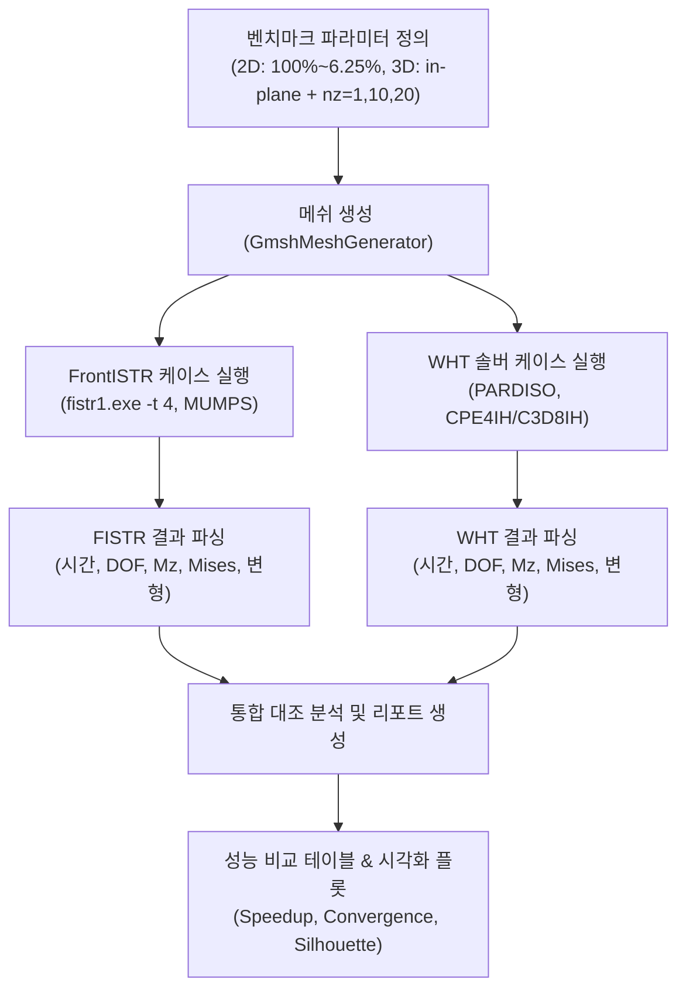

# FrontISTR vs WHT Solver 2D/3D 메쉬 세분화 벤치마크 및 성능·정확도 비교 계획서

## 1. 개요 및 목적 (Goal Description)
본 계획은 오픈소스 대규모 병렬 FEM 솔버 **FrontISTR (`fistr1.exe`)**와 자체 비선형 솔버 **`WHT_DispFoldSolver`**의 수치역학적 성능(해석 시간, 스케일링, 하중-응력-변형률, 변형 형상)을 체계적으로 계측·대조하기 위한 벤치마크 프레임워크를 수립하고 실행하는 것을 목적으로 합니다.

요소 크기를 50%씩 4단계 세분화(100% $\to$ 50% $\to$ 25% $\to$ 12.5% $\to$ 6.25%)하여 수치적 수렴성(h-convergence)과 자유도(DOF) 증가에 따른 솔버 속도 및 메모리 거동을 정밀 검증합니다.

---

## 2. 사용자 검토 및 결정 필요 사항 (User Review Required)

> [!IMPORTANT]
> **1. 적층 프리셋(Laminate Preset) 선정: `compact_4` vs `teardrop`**
> - **권장**: **`compact_4` (4개 층: PET-PSA-PET-GLASS)**를 메인 벤치마크 대상으로 진행.
>   - 6.25% (16배 세분화) 및 3D $nz=20$ 해석 시 요소 수가 급격히 증가하므로, 솔버 간 공정하고 빠른 h-수렴성 검증에 최적입니다.
>   - 사용자 승인 시, 100% 및 50% 기준 대표 케이스에 대해 `teardrop` (14개 층) 확장 검증을 추가 수행할 수 있습니다.
>
> **2. 2D 요소 크기 세분화 방식 ($X$ 방향 vs $X \times Y$ 등방 세분화)**
> - **방안 A (권장 — 길이 방향 $X$ 세분화, 층 두께 방향은 층당 형상비 제어)**:
>   - 폴더블 디스플레이 박막은 두께가 $30\,\mu\text{m} \sim 60\,\mu\text{m}$로 극도로 얇습니다. 두께 방향으로 균일 16분할 시 $dy \approx 1.8\,\mu\text{m}$가 되어 병전 왜곡이 커지므로, 굽힘 변형을 주도하는 힌지 길이 방향 요소 크기 $h_x$를 50%씩 반감(요소 수 1x, 2x, 4x, 8x, 16x)합니다.
>   - 100% ($h$): `nx_hinge=30`, `nx_plate=20` (총 $nx=70$)
>   - 50% ($h/2$): `nx_hinge=60`, `nx_plate=40` (총 $nx=140$)
>   - 25% ($h/4$): `nx_hinge=120`, `nx_plate=80` (총 $nx=280$)
>   - 12.5% ($h/8$): `nx_hinge=240`, `nx_plate=160` (총 $nx=560$)
>   - 6.25% ($h/16$): `nx_hinge=480`, `nx_plate=320` (총 $nx=1120$)
> - **방안 B ($X \times Y$ 동시 세분화)**:
>   - 층 두께 방향 요소 수 `ny_elements`도 비례 증가 ($1, 2, 4, 8, 16$). 6.25%에서 2D 절점 수 $\sim 10$만 개($\sim 60$만 DOF)로 증가하여 MUMPS/PARDISO 계산 시간이 크게 증가함.

---

## 3. 상세 테스트 매트릭스 (Test Matrix)

### Part 1. 2D 폴딩 테스트 (FrontISTR)
- **요소 크기 조건**:
  | 구분 | 요소 크기 ($h$) | 분할 배수 | Hinge $nx$ | Plate $nx$ | 2D 총 $nx$ | 예상 노드 수 (361 기준) |
  |:---:|:---:|:---:|:---:|:---:|:---:|:---:|
  | Level 0 | **100%** | $1\times$ | 30 | 20 | 70 | ~850 |
  | Level 1 | **50%** | $2\times$ | 60 | 40 | 140 | ~1,700 |
  | Level 2 | **25%** | $4\times$ | 120 | 80 | 280 | ~3,400 |
  | Level 3 | **12.5%** | $8\times$ | 240 | 160 | 560 | ~6,700 |
  | Level 4 | **6.25%** | $16\times$ | 480 | 320 | 1,120 | ~13,400 |
- **계측 및 비교 지표**:
  1. **해석 속도**: Wall time (초), fistr solve time, MUMPS setup(Factorization) vs solve(Triangular solve) 시간, 서브스텝당 평균 뉴턴 반복 수
  2. **하중 (Load)**: 피벗 구동 모멘트 $M_{\text{drive}}(\theta = 90^\circ)$, 고정단/구동단 반력 합력 $F_x, F_y$
  3. **응력 (Stress)**: 힌지 중앙부 최대 von Mises 응력 (PET 외측, PSA 전단부, Glass)
  4. **변형률 (Strain)**: 점착층(PSA) 최대 전단 변형률 $\gamma_{xy}$ 및 수직 변형률

---

### Part 2. 3D 폴딩 테스트 (FrontISTR)
- **비교군 1: 평면 내(In-plane) 요소 크기 비교**
  - 요소 크기 **100%, 50%, 25%** (기본 깊이 $nz = 2$)
  - 해석 속도, 구동 하중, von Mises 응력, 변형률 거동 비교
- **비교군 2: 깊이 방향(Z-depth, 폭 1.0mm) 요소 수 비교**
  - **요소 크기 100% 기준**: $nz = 1$, $nz = 10$, $nz = 20$ (3개 케이스)
  - **요소 크기 50% 기준**: $nz = 1$, $nz = 10$, $nz = 20$ (3개 케이스)
  - 폭 방향 면외 변위($u_z$, 포아송 팽창 / 안티클라스틱 휨), 3D 구속 효과 및 요소 수 증가에 따른 연산 시간 계측

---

### Part 3. 동일 요소 크기 조건에서 WHT 솔버 vs FrontISTR 대조
- **대조 조건**:
  - 2D: 100%, 50%, 25% (WHT `DynamicSolver2D` + `2D-Opt1-IH` [`CPE4I_CR` + `CPE4IH_CR`])
  - 3D: 100% ($nz=1, 2, 10$) 및 50% ($nz=1, 2$) (WHT `DynamicSolver3D` + `3D-Opt1-IH` [`C3D8I_CR` + `C3D8IH_CR`])
- **대조 항목**:
  1. **계산 속도**: Intel oneMKL PARDISO (`WHT`) vs MUMPS (`FrontISTR`) 스텝당 해석 시간, 총 소요 시간
  2. **하중 및 모멘트**: 최종 180° 폴딩 시 피벗 구동 모멘트 $|M_z|$, 반력 평형
  3. **응력 및 변형률**: 최대 von Mises 응력 $\sigma_{\text{vM}}$, PSA 층간 슬립량 $\Delta u_x$
  4. **변형 형상**: Tear-Drop 벌브 폭 ($\Delta X_{\text{hinge}}$), 정점 처짐 ($Y_{\text{apex}}$), 2D/3D 프로파일 오버레이 일치도

---

## 4. 변경 및 신규 파일 구조 (Proposed Changes)

### 벤치마크 및 분석 스크립트
#### [NEW] `example_disp_fold/benchmark_mesh_refinement_fistr_wht.py`
- 파라미터화된 메쉬 생성기(`MeshSpec(nx_hinge, nx_plate, nz_elements)`)와 연동
- FrontISTR 2D (5수준) 및 3D (Z방향 스케일링 포함) 자동 배치 실행기
- WHT 솔버 자동 연동 및 공통 인터페이스 결과 수집기
- 종합 성능 비교표 (Markdown 및 CSV) 및 Matplotlib/PyVista 시각화 생성

#### [MODIFY] `example_disp_fold/run_fistr_teardrop.py`
- `run_fistr_case` 함수에 `mesh_scale` 또는 `mesh_spec` 인자를 전달할 수 있도록 확장 (기존 기본값 보존)

#### [NEW] `dev_log/benchmark_mesh_refinement_fistr_wht_YYYYMMDD.md`
- 벤치마크 실행 결과 수치, 성능 그래프, 응력-변형률 분석 보고서 기록

---

## 5. 실행 워크플로우 다이어그램 (Workflow)

---

## 6. 검증 계획 (Verification Plan)

### 자동 검증 절차
1. **메쉬 유효성 전수 검사**: 모든 세분화 레벨에서 `det J > 0` 검증 (GmshMeshGenerator 내부 검증기 통과 필수)
2. **2D FISTR 5단계 실행**: `100%, 50%, 25%, 12.5%, 6.25%` 순차 구동 및 각 단계 완료(`FrontISTR Completed !!`) 확인
3. **3D FISTR 7개 케이스 실행**:
   - 100% mesh × $nz \in \{1, 10, 20\}$
   - 50% mesh × $nz \in \{1, 10, 20\}$
   - 25% mesh × $nz = 1$
4. **WHT 솔버 매칭 케이스 실행**: 동일 메쉬에 대한 `DynamicSolver2D` / `DynamicSolver3D` 구동
5. **결과 수치 무결성 검증**:
   - 작용-반작용 좌우 모멘트 대칭 오차 < 0.1%
   - 요소 세분화에 따른 반력 모멘트 $M_z$의 점근적 수렴 확인 (h-convergence)

---

## 7. 오픈 질문 및 제안
1. **서브스텝 수**: 현재 기본값인 90 서브스텝(스텝당 $1.0^\circ$ 회전)으로 진행할지, 아니면 속도 비교 벤치마크의 신속한 완주를 위해 30 서브스텝($3.0^\circ$ 회전)으로 우선 계측할지 선택 가능합니다 (30 서브스텝에서도 동일한 2차 수렴 확인됨).
2. 계획서의 내용(메쉬 세분화 방안 A, `compact_4` 프리셋 대상)으로 진행을 승인해 주시면 즉시 구현 및 측정을 시작하도록 하겠습니다.
