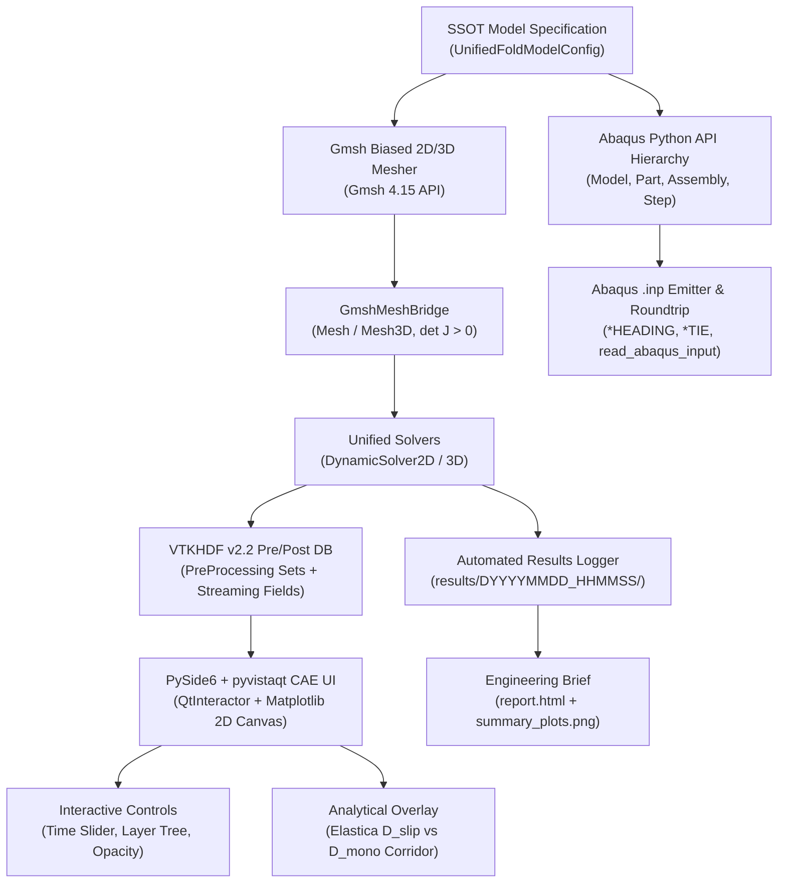

# [Architecture & Implementation Plan] 통합 2D/3D 다층 디스플레이 티어드롭 폴딩 프레임워크 (`example_disp_fold/`) - 확장 확정안

> **문서 버전:** 2.0.0 (사용자 피드백 및 8대 확장 기능 전면 반영)  
> **작성 일자:** 2026-10-18  
> **대상 모듈:** `example_disp_fold/` 디렉토리 신설 및 `ex1_dispfold_teardrop.py`  
> **핵심 목적:** 기존 `ex12`(2D)와 `ex13`(3D)로 분산되어 있던 티어드롭 폴딩 해석 모델을 단일 객체지향 아키텍처로 완전 통합하고, **Gmsh 점진적 바이어스 메쉬, VTKHDF v2.2 전/후처리 데이터베이스, Abaqus API 패리티 및 .inp 라운드트립 검증, PySide6 + pyvistaqt 통합 CAE 윈도우(시간 동기화 슬라이더, 레이어 트리뷰, 실시간 스트리밍, 이론해 음영 오버레이), 1-Page HTML 엔지니어링 브리프**를 완벽 구현.

---

## 1. 확정된 시스템 아키텍처 다이어그램



---

## 2. 세부 디렉토리 및 모듈 구성

```
example_disp_fold/
├── __init__.py                     # 패키지 선언
├── ex1_dispfold_teardrop.py        # [메인 실행 엔트리포인트] CLI, 솔버 루프, 결과 아카이빙 총괄
├── model_spec.py                   # [SSOT 데이터 구조] Layer, Material, Hinge, Preset, 접촉가드, 예측자 스펙
├── gmsh_mesh_generator.py          # [Gmsh 메셔] 힌지 조밀-플레이트 점진적 바이어스(Biased Sizing) 2D/3D 메쉬
├── abaqus_api_builder.py           # [Abaqus API & INP] 계층 모델 구성, .inp 파일 출력 및 라운드트립 무결성 검증
├── vtkhdf_unified_io.py            # [VTKHDF v2.2 DB] 전처리(Sets/Parts) + ParaView CellData + 후처리 시계열
├── viewer_qt_app.py                # [PySide6+pyvistaqt] 좌측 3D 뷰 + 우측 Matplotlib UI + 슬라이더 + 레이어 트리
├── report_generator.py             # [1-Page 엔지니어링 브리프] report.html 자동 생성기
└── results/                        # [결과 아카이브]
    └── DYYYYMMDD_HHMMSS/           # 스탬프별 독립 결과 폴더
        ├── run.log                 # 터미널 전체 실시간 로깅 (Tee Logger)
        ├── model.inp               # 생성된 Abaqus 호환 키워드 입력 데크
        ├── model_and_results.vtkhdf# 전/후처리 통합 VTKHDF 파일
        ├── summary_plots.png       # 모멘트-회전각, 슬립, 잔차 이력 X-Y 고해상도 플롯
        ├── folding_animation.gif   # 폴딩 과정 애니메이션
        ├── result_summary.json     # 정량 역학 평가 지표
        └── report.html             # 1-Page 인터랙티브 웹 브리프 리포트
```

---

## 3. 핵심 확정 기능 상세 명세

### 3.1 SSOT 데이터 모델 & 기구학 프리셋 (`model_spec.py`)
- **다채로운 힌지 기구학 프리셋**:
  * `teardrop` (표준 방울형): 넥 갭 $2.8\,\text{mm}$, 힌지 스팬 $15.0\,\text{mm}$ (정본 14층)
  * `u_shape` (클래식 반원): 피벗 $0.0\,\text{mm}$, 고정 반경 $R=1.5\,\text{mm}$
  * `compact_waterdrop` (슬림형): 넥 갭 $1.5\,\text{mm}$, 힌지 스팬 $10.0\,\text{mm}$
  * `crease_zero_gap` (완전 밀착): 피벗 $0.0\,\text{mm}$, Dual Mortar 접촉 자동 강제
  * `compact_4` (스모크 테스트): 4개 층 고속 검증용
- **지능형 접촉 활성화 가드**: 피벗 거리 $x_{\text{pivot}} < 0.8\,\text{mm}$ 감지 시 자동으로 `DUAL_MORTAR` 접촉 연동.
- **회전 선행 예측자(`enable_predictor: bool`)**: CLI 및 스펙 옵션화 (`--enable_predictor` / `--no_predictor`).

### 3.2 Gmsh 4.15 점진적 바이어스 메쉬 생성기 (`gmsh_mesh_generator.py`)
- **Biased Progression 전략**:
  - 힌지 중앙 곡률부($[-7.5, +7.5]\,\text{mm}$): $dx \approx 0.2\,\text{mm}$의 조밀 요소.
  - 플레이트 지지부($|x| \in [7.5, 40.0]\,\text{mm}$): $dx \approx 0.8 \sim 1.0\,\text{mm}$로 점진적 확장(`Progression 1.15`).
  - 힌지 1층 PSA 보이드(Void) 영역 자동 제외.
  - 2D: Transfinite Quad (`setRecombine`), 3D: Z축 Extruded Hex (`det J > 0` 전수 검증).

### 3.3 Abaqus API 및 .inp 라운드트립 무결성 (`abaqus_api_builder.py`)
- `Model`, `Part`, `Assembly`, `Step`, `SolutionControl(ADAPTIVE)` 구성.
- `model.write_inp()`로 Abaqus 키워드 데크 방출.
- `dispsolver.io.read_abaqus_input`을 통해 즉각 파싱하여 절점 수, 요소 수, 세트 명칭이 100% 일치하는지 라운드트립 자동 검증.

### 3.4 VTKHDF Version 2.2 전/후처리 데이터베이스 (`vtkhdf_unified_io.py`)
- Kitware VTKHDF v2.2 표준 UnstructuredGrid.
- **ParaView 네이티브 필터링 지원**: `CellData/Layer_ID`, `CellData/Part_ID`, `CellData/Material_Type` 기록.
- **PreProcessing 메타데이터**: Parts, NodeSets, ElementSets, Surfaces, Material JSON 저장.
- **PostProcessing 스트리밍**: 스텝별 `Displacement`, `Mises_Stress`, `Hydrostatic_Pressure`, `Interlayer_Slip` 시계열 추가.

### 3.5 PySide6 + pyvistaqt 통합 CAE 윈도우 UI (`viewer_qt_app.py`)
- **좌측 뷰포트**: `pyvistaqt.QtInteractor` (3D/2D 인터랙티브 렌더링, Dark Paraview 테마, 뷰 단축키 1,2,3,4,P,S).
- **우측 대시보드 패널**: `FigureCanvasQTAgg` (Matplotlib, **9pt Noto Sans KR / Malgun Gothic**).
  - 층간 슬립 곡선 ($U_{\text{slip}}$ vs $y$).
  - 구동 모멘트 곡선 ($M_{\text{drive}}$ vs $\theta$) + **Elastica 이론해 ($D_{\text{slip}}$ vs $D_{\text{mono}}$) 음영 밴드 오버레이**.
  - 스텝별 뉴턴 반복수 및 평형 잔차 이력.
- **인터랙티브 컨트롤바**:
  - 하단 시간 증분 슬라이더(QSlider) & Play/Pause 버튼 $\to$ 좌측 3D 형상과 우측 2D 그래프의 커서가 실시간 동기화.
  - 좌측 상단 레이어별 가시성(Visibility) 체크박스 트리뷰 & 투명도(Opacity) 슬라이더.
- **라이브 스트리밍 모드 (`--live`)**: 백그라운드 QThread 솔버와 연동하여 스텝 수렴 시마다 실시간 화면 갱신.

### 3.6 원클릭 1-Page HTML 엔지니어링 브리프 (`report_generator.py`)
- `results/DYYYYMMDD_HHMMSS/report.html` 자동 생성.
- 적층 제원, 재료 물성치, 최종 구동 모멘트, 최대 층간 슬립량($\mu\text{m}$), 정적 평형 오차율, 최종 형상 이미지, 모멘트-각도 곡선 그래프가 포함된 단일 인터랙티브 HTML 웹 보고서.

---

## 4. 단계별 구현 및 검증 체크리스트

- [ ] **Step 1: 데이터 모델 및 프리셋 구현 (`model_spec.py`)**  
  *검증:* 2D/3D 전환, 프리셋 로드, 지능형 접촉 가드, 예측자 플래그 단위 테스트.
- [ ] **Step 2: Gmsh 4.15 바이어스 메셔 구현 (`gmsh_mesh_generator.py`)**  
  *검증:* 2D Quad 및 3D Hex 메쉬 생성, `det J > 0` 무결성, 바이어스 분할 검증.
- [ ] **Step 3: Abaqus API 빌더 및 .inp 라운드트립 (`abaqus_api_builder.py`)**  
  *검증:* .inp 파일 방출 및 `read_abaqus_input` 재독해 1:1 토폴로지 대조.
- [ ] **Step 4: VTKHDF v2.2 전/후처리 입출력기 (`vtkhdf_unified_io.py`)**  
  *검증:* 전처리 세트 및 후처리 시계열 저장 후 h5py / PyVista 정상 로드 확인.
- [ ] **Step 5: 1-Page HTML 리포트 생성기 (`report_generator.py`)**  
  *검증:* HTML 파일 렌더링 및 주요 지표 수치 포맷 검증.
- [ ] **Step 6: PySide6 + pyvistaqt 통합 인터랙티브 뷰어 (`viewer_qt_app.py`)**  
  *검증:* 시간 슬라이더 동기화, 레이어 트리뷰 가시성, Matplotlib 이론해 음영 밴드 렌더링.
- [ ] **Step 7: 메인 실행기 (`ex1_dispfold_teardrop.py`) 및 End-to-End 검증**  
  *검증:* 2D 및 3D 스모크/완전 테스트 구동, `results/DYYYYMMDD_HHMMSS/` 산출물 전수 확인.
